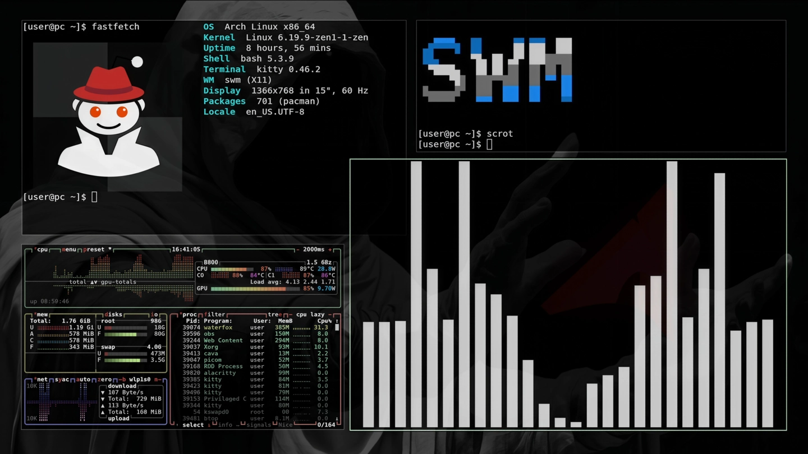
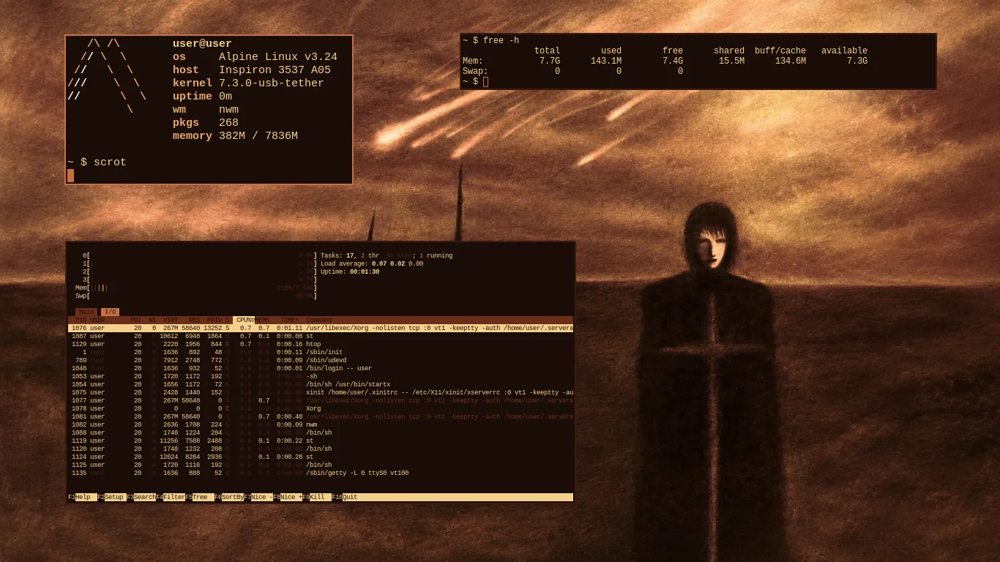
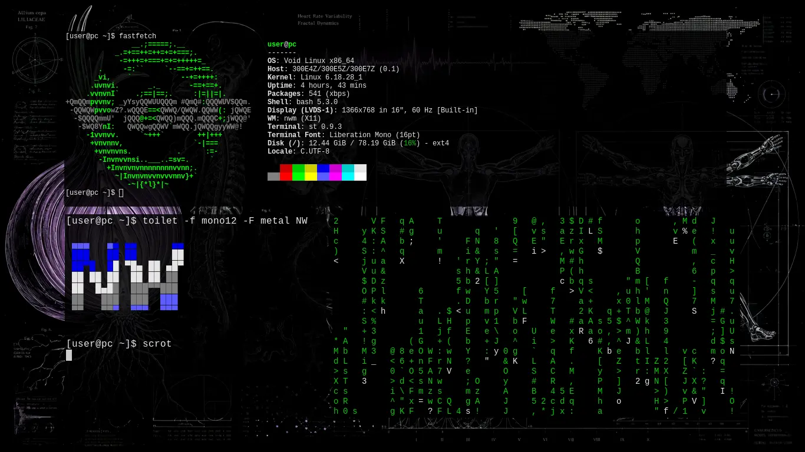
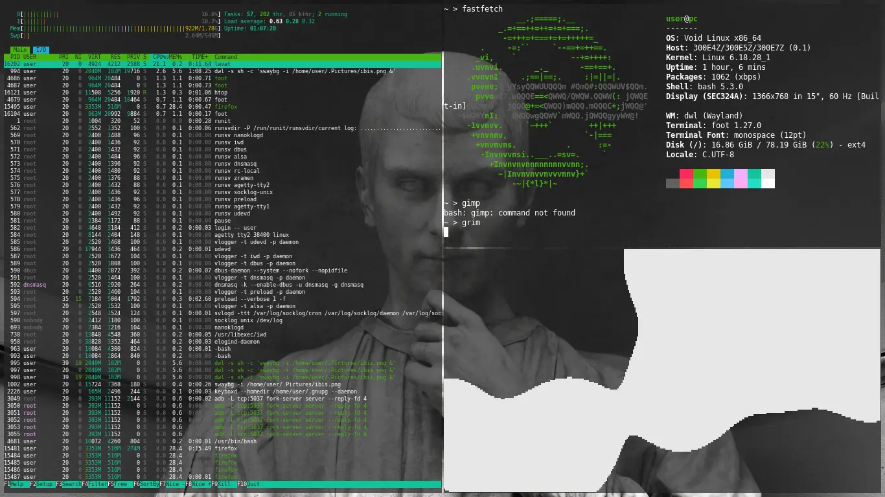
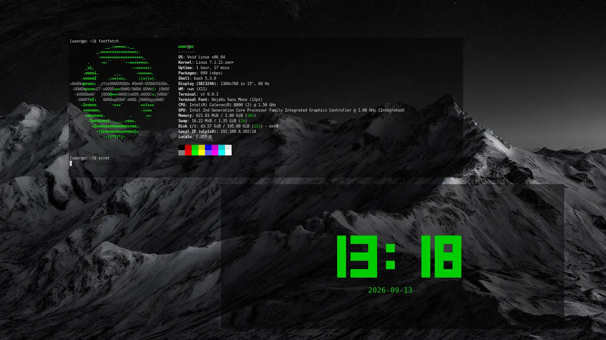
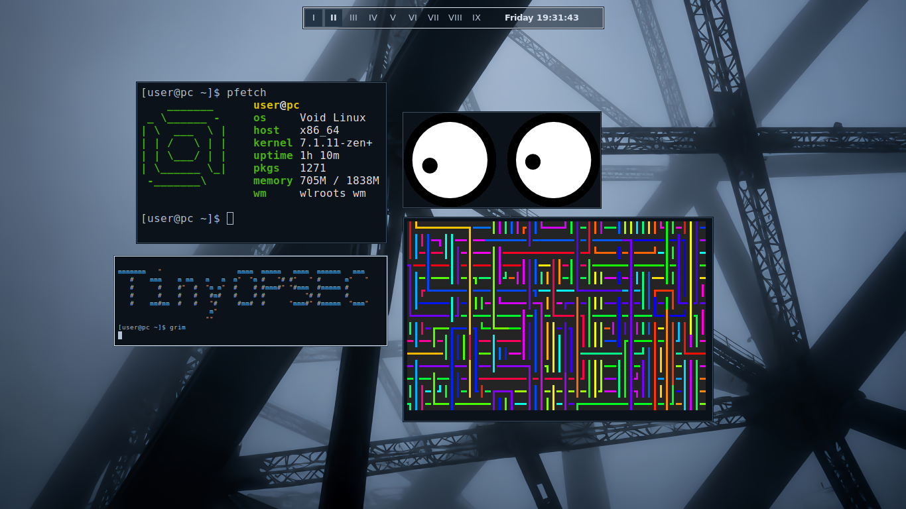
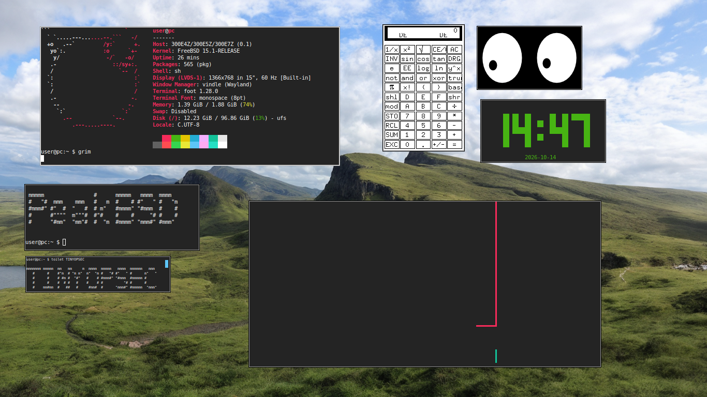

# distrohop

> Screenshots of the systems I've used and set up.
>
> *From small Alpine containers to my Arch desktop.*

_Still a work in progress. I add screenshots as I go._

---

## Arch Linux

> Primary workstation. Tiling window managers, custom kernel tweaks, and a clean dark aesthetic.

  
  
  

---

## Alpine Linux

> Very small and light. I use it for containers, VMs, and testing on old hardware.

  
  
  
  

---

## Void Linux

> A rolling release without systemd. I like that XBPS is fast and runit is easy to understand.

  
  
  
  
  
  
  
  

---

## FreeBSD

> I mostly use it for ZFS and jails. The ports collection is a nice bonus.

  

---

## Collection notes

- **Why screenshots?** Dotfiles show what I use, screenshots show how it actually looks.
- **Format:** Images are WebP, so the files stay small.
- **Status:** Work in progress. I update it when a setup changes.

---

## License

MIT. See [LICENSE](./LICENSE) for details.

   
  

