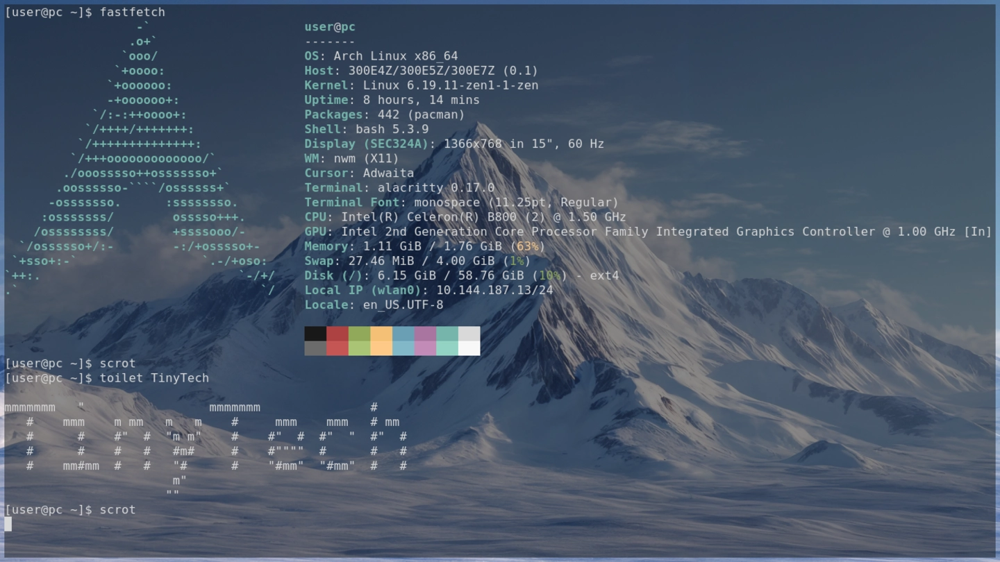
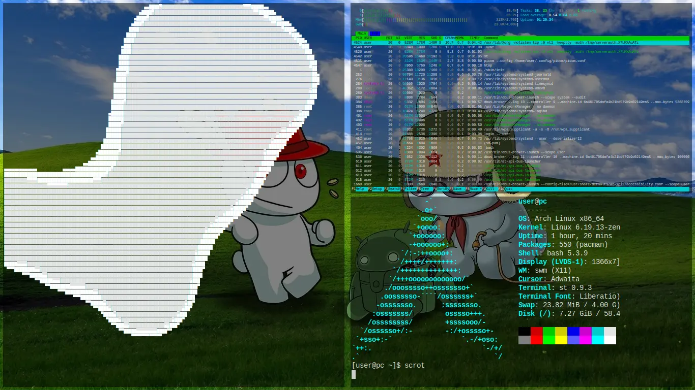
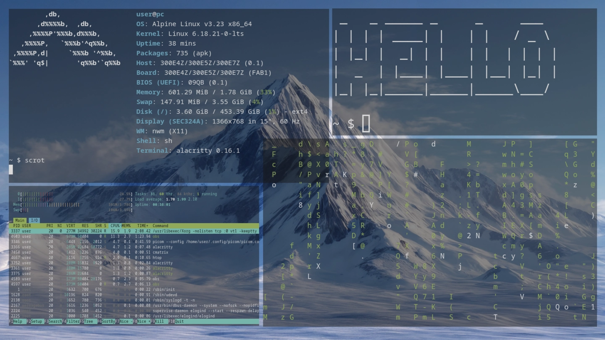
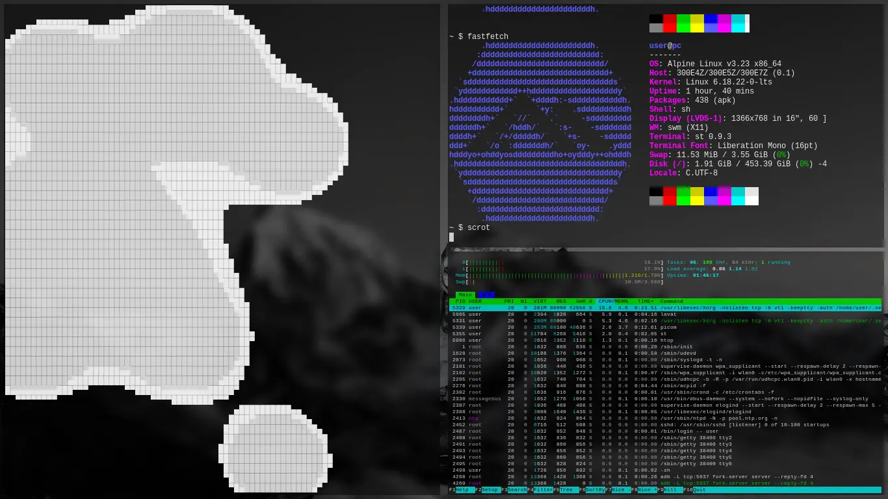
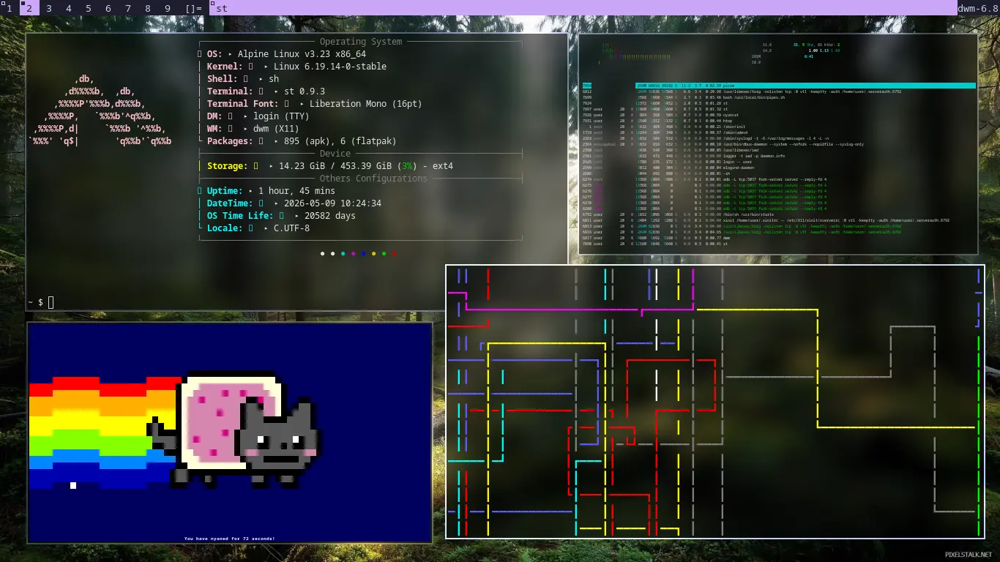
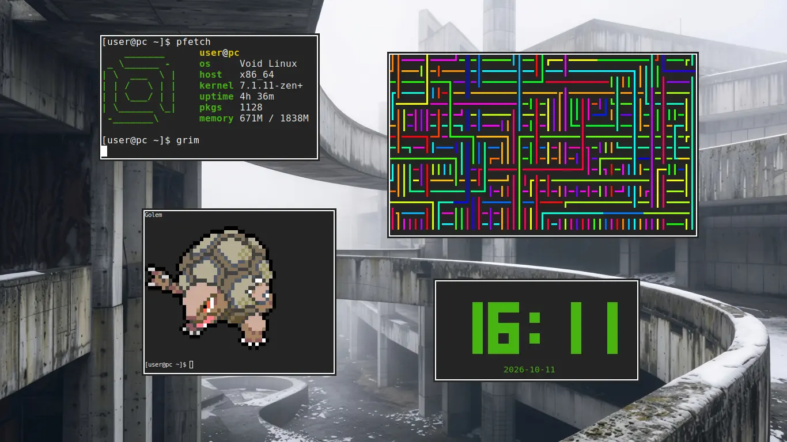
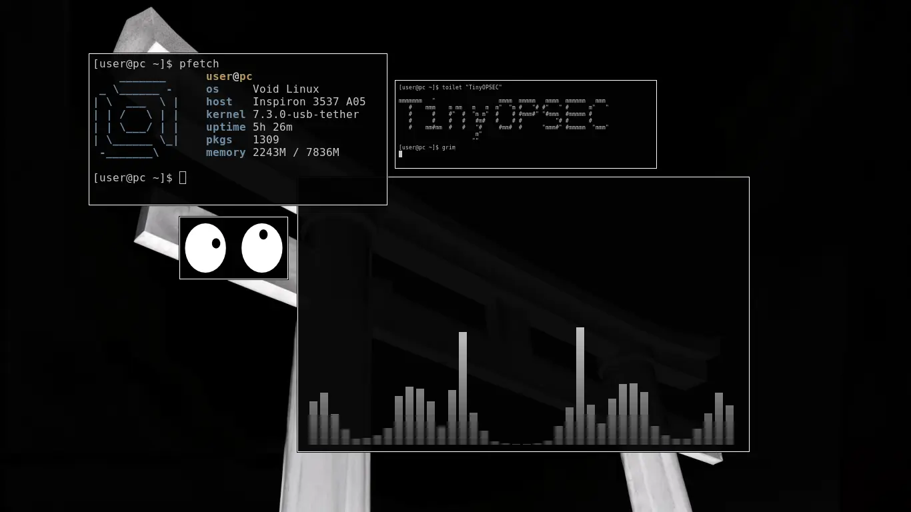
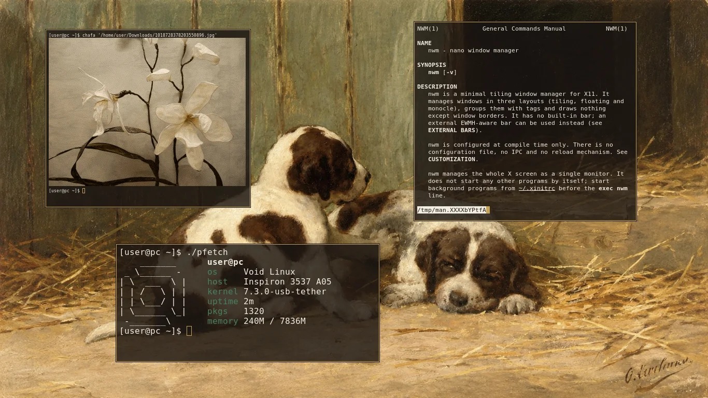
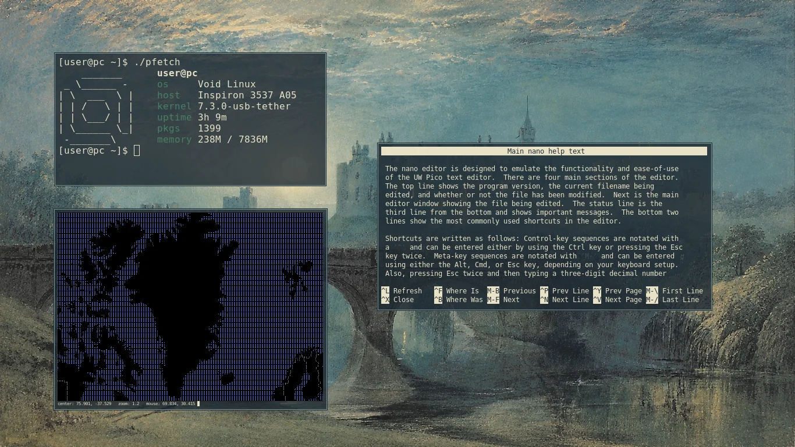

# distrohop

> A visual log of systems I've used and configured.
>
> *From minimal Alpine containers to fully riced Arch setups.*

_Screenshot collection, work in progress._

---

## Arch Linux

> Primary workstation. Tiling window managers, custom kernel tweaks, and a clean dark aesthetic.

  
  
  

---

## Alpine Linux

> The lightweight powerhouse. Used for containers, VMs, and testing on ancient hardware. Busybox supremacy.

  
  
  
  

---

## Void Linux

> Rolling release without systemd. XBPS is fast and reliable, runit keeps things simple and predictable.

  
  
  
  
  
  
  
  

---

## FreeBSD

> The complete operating system. ZFS, jails, and a ports collection with decades of history.

  

---

## Collection notes

- **Why screenshots?** Because dotfiles tell *what* you use, but screenshots tell *how* you use it.
- **Format:** All images are optimized WebP for size and quality.
- **Status:** Work in progress. Updated whenever a setup changes.

---

## License

MIT. See [LICENSE](./LICENSE) for details.

   
  

