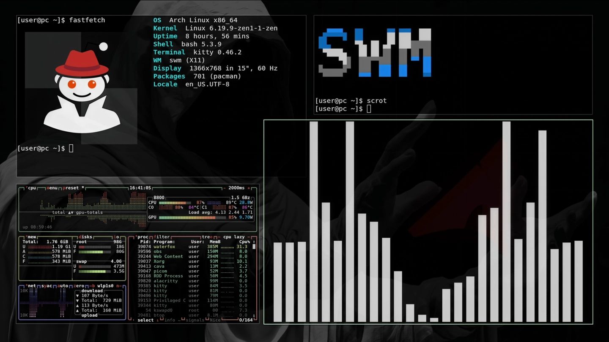
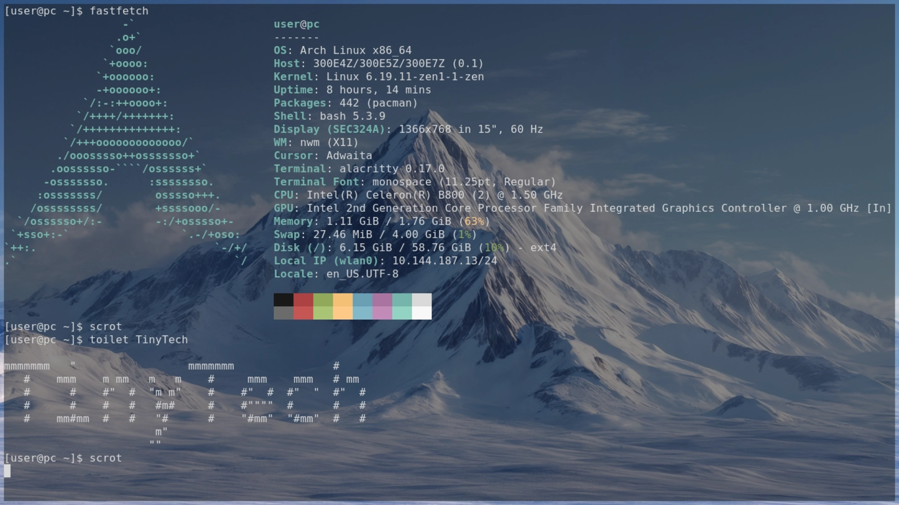
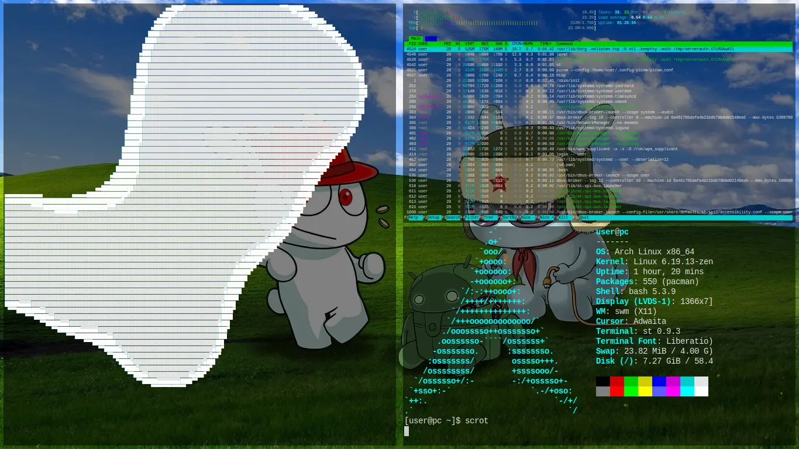
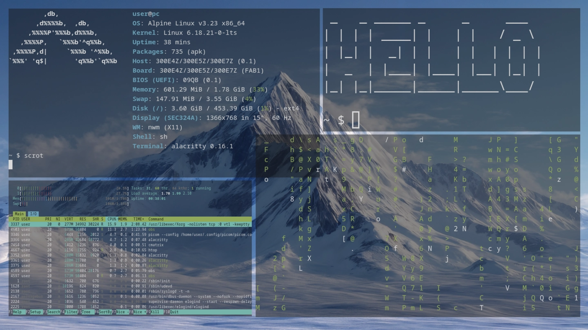
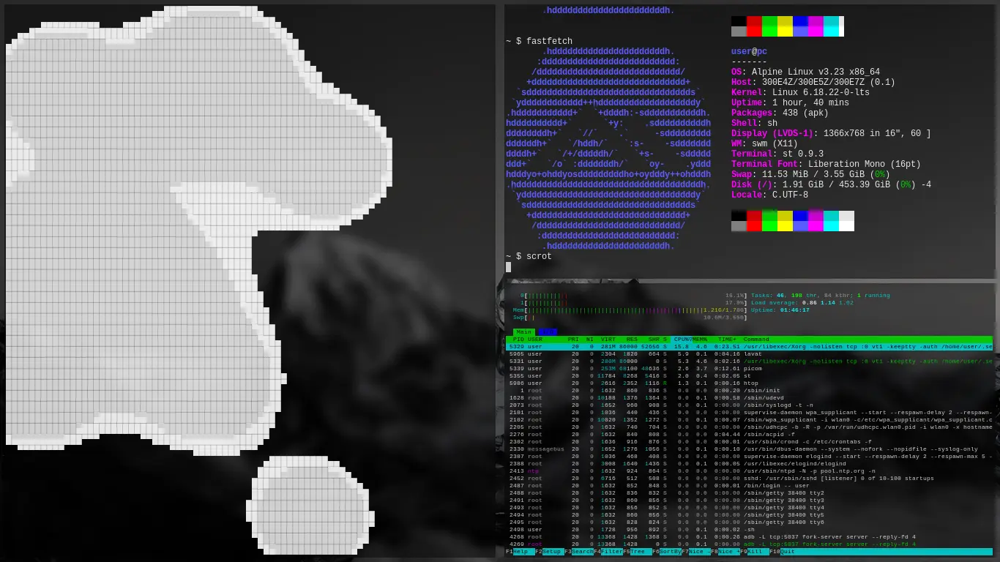
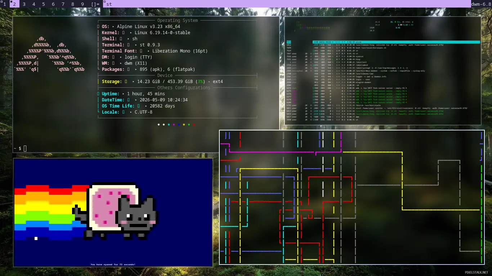
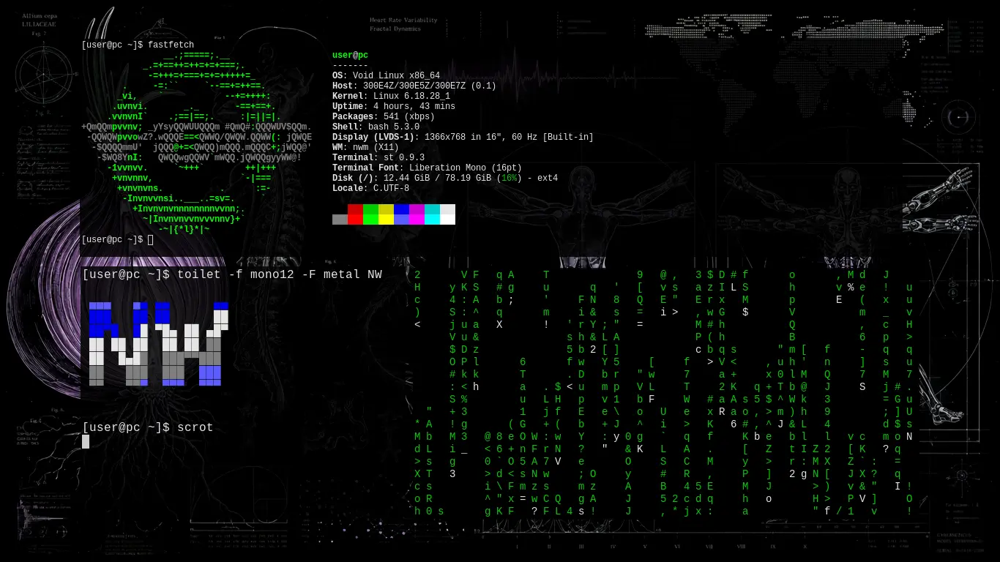
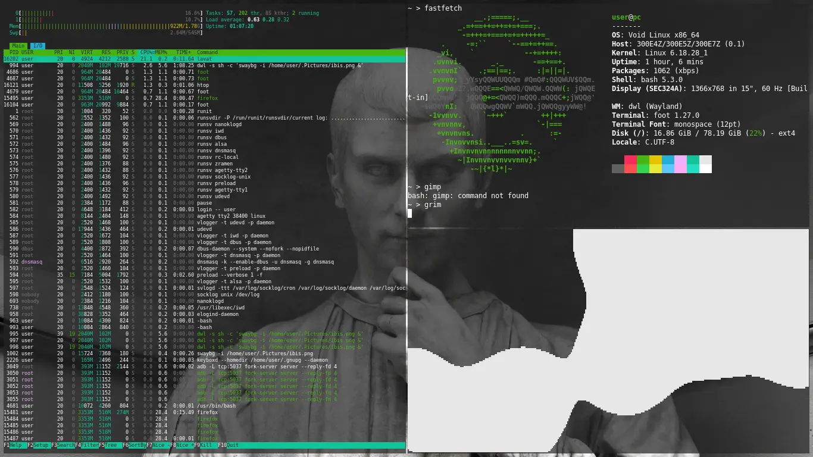
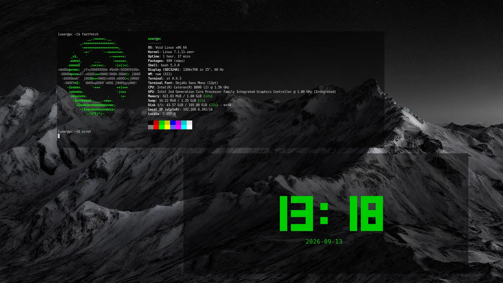
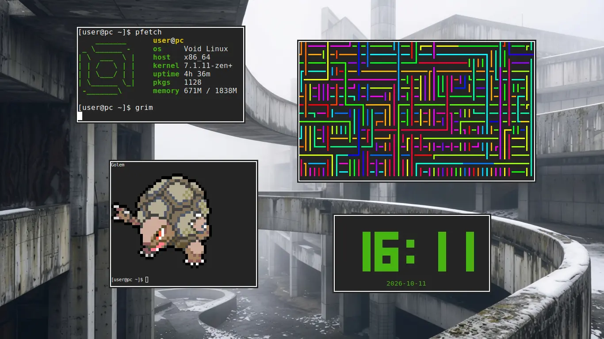

<div align="center">

# distrohop

> A visual log of systems I've used and configured.
>
> *From minimal Alpine containers to fully riced Arch setups.*

[](https://github.com/tinyopsec/distrohop)
[](./assets)
[](https://github.com/tinyopsec/distrohop)
[](./LICENSE)

_Screenshot collection, work in progress._

</div>

---

## Contents

- [About](#about)
- [Arch Linux](#arch-linux)
- [Alpine Linux](#alpine-linux)
- [Void Linux](#void-linux)
- [Repository structure](#repository-structure)
- [Collection notes](#collection-notes)
- [License](#license)

---

## About

This repository is a screenshot journal of Linux systems I run and experiment with. Not just dotfiles, but the actual look and feel of each setup.

---

## Arch Linux

> Primary workstation. Tiling window managers, custom kernel tweaks, and a clean dark aesthetic.

<p align="center">
  
  
  
</p>

---

## Alpine Linux

> The lightweight powerhouse. Used for containers, VMs, and testing on ancient hardware. Busybox supremacy.

<p align="center">
  
  
  
</p>

---

## Void Linux

> Rolling release without systemd. XBPS is fast and reliable, runit keeps things simple and predictable.

<p align="center">
  
  
  
  
</p>

---

## Repository structure

```text
distrohop/
├── assets/
│   ├── arch*.webp     # Arch Linux screenshots
│   ├── alpine*.webp   # Alpine Linux screenshots
│   └── void*.webp     # Void Linux screenshots
├── LICENSE
└── README.md
```

---

## Collection notes

- **Why screenshots?** Because dotfiles tell *what* you use, but screenshots tell *how* you use it.
- **Format:** All images are optimized WebP for size and quality.
- **Status:** Work in progress. Updated whenever a setup changes.

---

## License

MIT. See [LICENSE](./LICENSE) for details.

<p align="center">
  <br>
  <a href="https://github.com/tinyopsec">
    
  </a>
</p>
